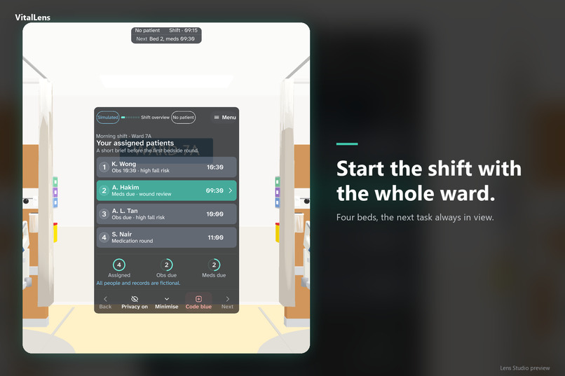
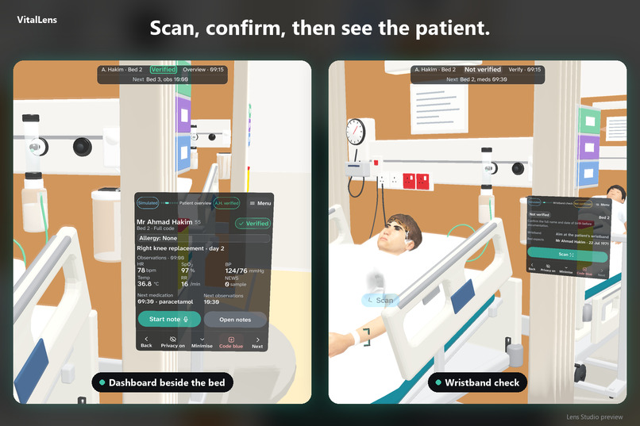
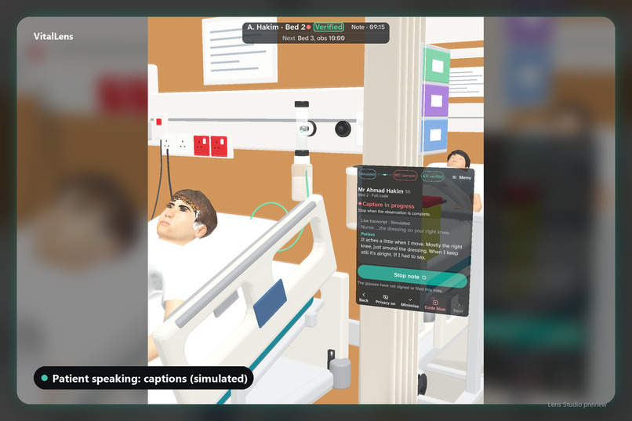
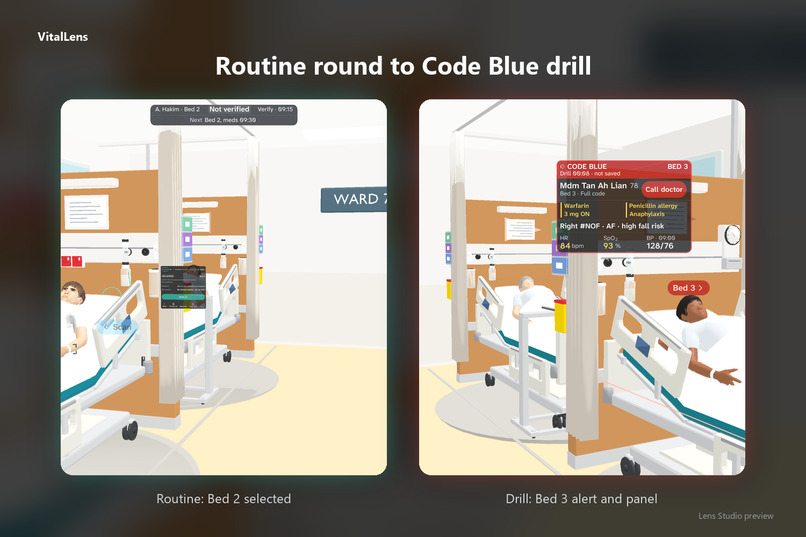

# VitalLens

**Nurses shouldn't have to leave the bedside to find the right information.** VitalLens is a SPECS Lens that confirms the right patient from the wristband, then puts that patient's records beside the bed, hands-free, through a whole fictional ward round.

▶ **[Watch the demo](https://www.youtube.com/watch?v=jouyxs9p3jo)** · Built for [Learn AR with SPECS](https://learn-specs.devpost.com/) · [Devpost entry](https://devpost.com/software/vitalens-v2qpt1) · Evaluation only, see [LICENSE](LICENSE)

## Why glasses, not a phone

A nurse's hands are busy and their eyes need to stay on the patient. Glasses can put the right record beside the right bed after a wristband check, without picking up a device or walking back to a workstation. Whether that beats a phone or a ward computer is what we want to test with nurses next.

## One ward round, start to finish

1. **Start the shift.** The nurse sees their four assigned beds and what each patient needs next.
2. **Check the patient.** A wristband scan and two identifiers confirm the right patient before anything patient-specific opens. A mismatch stops everything. There is no face recognition.
3. **See the patient beside the bed.** A compact overview with allergies, observations and the next tasks sits next to the patient, not in front of the nurse's face.
4. **Capture a note.** The nurse dictates while captions show what is being said. A simulated AI draft is reviewed and deliberately saved for review on the ward computer. The glasses never sign or file anything.
5. **Respond to a Code Blue drill.** A short alert guides the nurse to Bed 3 while walking, then a fuller board opens at the bedside.
6. **Hand over.** A summary is built only from saved notes, with sources and pending tasks, and is reviewed separately.

## Built to be safe by design

The hard part of bedside software is not the screens, it is the rules. These are enforced in one shared state model and covered by tests:

- Nothing patient-specific opens until the patient is verified, and switching patient clears the encounter.
- Drafts are never approved by navigation, waiting or a timer. Only a deliberate save changes them.
- Editing a saved note marks any handover built from it as stale.
- Unknown facts stay "Unknown", and pending tasks stay pending.
- Privacy stops capture and never restarts it on its own.
- Every simulated part (scan, transcript, AI draft, vitals, handover) is labelled where it appears.

## How we built it

- **Lens Studio 5.24** on the SPECS Base Template, with the SPECS Interaction Kit and UI Kit. Every action is a pinch target, and every voice action also has a button.
- **Planning:** the official Devpost Learn `plan-lens` skill pack is included in [`.agents/skills/plan-lens`](.agents/skills/plan-lens). We did not run its live interview. Our coding agent wrote the design brief from our written answers and storyboards, following the pack's template, and we reviewed and approved it. The public version is [`devpost/design-brief.md`](devpost/design-brief.md).
- **CLAD and the Lens Studio MCP:** coding agents (Kiro and Claude Code) worked inside the open Lens Studio project:
  - **Building:** CLAD skills (`specs-experience-builder`, `scene-construction`, `specs-build-ui`, `specs-interaction-recipes`, `mesh-builder-scripting`, `font-selector`, `icon-selector`, `build-sfx`) built the scene, UI Kit screens and interactions, meshes, fonts, icons and interface sounds.
  - **Checking:** after changes, the agents recompiled TypeScript (`RecompileTypeScriptTool`), read runtime logs (`RunAndCollectLogsTool`), queried the live scene and pinched buttons in Interactive Preview through the MCP.
  - **Testing:** LEAF scenarios, written with `specs-leaf-write-scenarios`, run in the preview through `specs-leaf-run-in-preview` and `verify-preview`. The encounter logic is also covered by **160 Node tests**, all passing, which run without Lens Studio.
- **A four-bed 3D ward** with fictional patients, so the preview feels like a real bay. On glasses, the ward is the real room; only the panels, markers and arrows are Lens content.

## Where to look

- [`Assets/Scripts/Core/`](Assets/Scripts/Core): the shared encounter state (`EncounterReducer.ts`, `EncounterSelectors.ts`) that enforces the rules above.
- [`Assets/Scripts/`](Assets/Scripts): the Lens screens, bedside dashboards and the Code Blue travel HUD.
- [`tests/core/`](tests/core): Node tests. Run `node --import ./register.mjs --test *.test.ts` in that folder.
- [`Assets/Tests/Leaf/`](Assets/Tests/Leaf): LEAF scenarios for the preview. Some older scenarios were written for the first layout and have not all been updated for the redesign.
- [`devpost/design-brief.md`](devpost/design-brief.md): the public design brief.

## Run it

1. Install Lens Studio 5.24 or later with SPECS support, plus Git LFS.
2. Clone the repository with Git LFS so the assets download.
3. Open `SpecsBaseTemplate.esproj` in Lens Studio and let the packages import.
4. Optional: to show the ward around you, run `python tools/build_ward_preview_source.py` (Python 3.10 or later). Then in Preview choose Interactive > From Lens Folder > `demo/ward/preview-source`.
5. Use Interactive Preview. A click acts as a pinch. Move with WASD, Q and E, and right-drag to look around.

## Safety and scope

Everything is fictional. Patient identification, dictation, AI drafting, vitals and filing are simulated with fixed sample data and labelled as simulated. There is no real patient data, face recognition, live capture, hospital or EHR connection, or treatment advice. It is not a medical device, and no clinical benefit or validation is claimed. Screenshots are from the Lens Studio preview.

## Earlier work

The concept comes from an NTU DR5004 course project (June to July 2026) and HTML storyboards made on 1 and 2 November 2026. No code, presentations or research documents from that earlier work are included. The Lens itself was built new during the hackathon submission period.

## Licence and third-party components

**Source-available for evaluation only. Not open source.** All rights, including patent rights, are reserved; see [LICENSE](LICENSE). The SPECS starter template (MIT), packages, fonts (SIL OFL 1.1), icons (Apache 2.0) and CC0 patient models keep their own licences. See [THIRD_PARTY_NOTICES.md](THIRD_PARTY_NOTICES.md) and [`licenses/`](licenses/).
